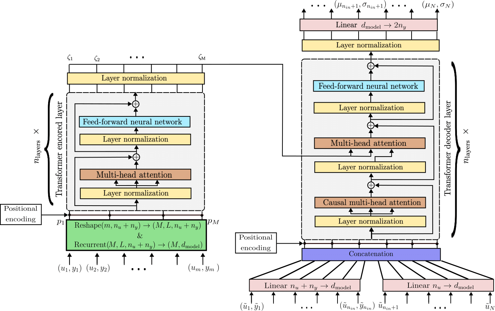

# In-Context Learning for System Identification: Probabilistic Formulation, Long-Sequence Handling, and Benchmark Validation

Code accompanying the paper *In-Context Learning for System Identification: Probabilistic Formulation, Long-Sequence Handling, and Benchmark Validation* by Matteo Rufolo, Dario Piga, Filippo Pura and Marco Forgione (Automatica 2026)

## Abstract 
 
Traditional system identification typically involves two steps: initially, training data is processed to estimate a model of the system of interest; then, the model is used to predict outputs for new input queries. In contrast, recent in-context learning approaches learn a meta model that maps directly from training data and query inputs to outputs in a zero-shot fashion, bypassing explicit model estimation. This approach leverages a meta model trained offline, on large sets of synthetically generated data, to emulate the behavior of a system identification algorithm. In this work, we advance this meta-learning framework for system identification in three directions. First, we develop a unified probabilistic meta-identification architecture that combines a Transformer-based encoder-decoder with tailored mechanisms for handling long training sequences, enabling calibrated predictions over long horizons. Second, we show how a pre-trained meta model can act as an uncertainty-aware synthetic data generator for classical system identification, providing task-specific data that regularize parametric models when real data are scarce. Third, we systematically evaluate the framework on standard nonlinear system identification benchmarks and on a challenging out-of-distribution scenario, demonstrating competitive accuracy with state-of-the-art methods and strong generalization, including cases where input-only adaptation is sufficient to handle significant distribution shifts. 


## Multi-step-ahead model-free simulation

With respect to the original paper we analyze only a multi-step-ahead simulation, using an updated encoder-decoder (machine-translation-like) Transformer architecture:

<!--  -->


# Main files

The training are performed on the WH system class, and its script is:

* [train_sim_WH_skip.py](train_sim_WH_skip.py)

The script above accept command-line arguments to customize the architecture and aspects of the training. 

Trained weights of all the Transformers discussed in the example section of the paper are available as assets in the [v0.1 Release](https://github.com/PuraFilippo/sysid_benchmarks/releases/tag/v0.1).

Jupyter notebooks that load the trained model to test ensambling and patching effectiveness on new data, [test_ensambling.ipynb](test_ensambling.ipynb) for in-distribution analysis and [test_CSTR_patching.ipynb](test_CSTR_patching.ipynb) for testing on a new system class (CSTR), and some recognized non-linear benchmarks ([benchmarks.ipynb](benchmarks.ipynb)).

A more in depth analysis on the CED bechmark through synthetic data is also performed through the [synthetic_CED.py](synthetic_CED.py) script.

# Software requirements
Experiments were performed on a Python 3.11 conda environment with:

 * numpy
 * scipy
 * matplotlib
 * numba
 * pytorch (v2.1.0)
 

These dependencies may be installed through the commands:

```
conda install pytorch -c pytorch
conda install numpy scipy matplotlib
conda install numba::numba
conda install -c conda-forge scikit-learn
```

For more details on pytorch installation options (e.g. support for CUDA acceleration), please refer to the official [installation instructions](https://pytorch.org/get-started/locally/).

The following packages are also useful:

```
conda install jupyter # (optional, to run the test jupyter notebooks)
pip install nonlinear-benchmarks (optional, to run the benchmarks jupyter notebook)
pip install dynonet # (optional, to run the synthetic CED experiment)
pip install wandb # (optional, for experiment logging & monitoring)
```

# Hardware requirements
While all the scripts can run on CPU, execution may be frustratingly slow. For faster training, a GPU is highly recommended.
To run the paper's examples, we used a server equipped with an nVidia RTX 3090 GPU.


# Citing

If you find this project useful, we encourage you to:

* Star this repository :star: 


* Cite the [paper](https://arxiv.org/abs/2610.13411) 
```
@article{forgione2023from,
  author={Rufolo, Matteo and Piga, Dario and Pura, Filippo and Forgione, Marco},
  journal={Automatica (in press)}, 
  title={In-Context Learning for System Identification: Probabilistic Formulation, Long-Sequence Handling, and Benchmark Validation}, 
  year={2026},
}
